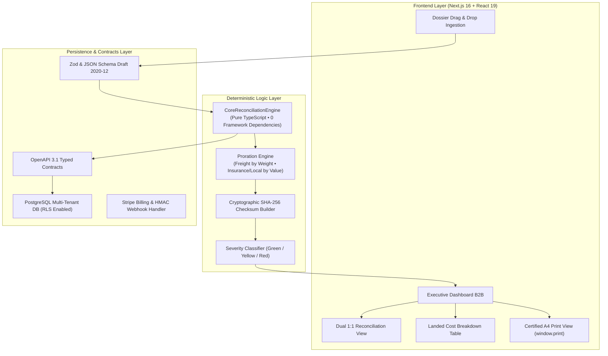

# LogiClear AI — Plataforma B2B de Conciliación Aduanera & Landed Cost Determinista

<p align="center">
  
  
  
  
  
  
  
</p>

---

## 🇪🇸 Descripción General (Español)

**LogiClear AI** es una plataforma Enterprise B2B SaaS diseñada para directores de operaciones, gerentes de finanzas y agentes de aduanas. Automatiza de extremo a extremo la conciliación documental de expedientes de importación, el cotejo 1:1 entre Facturas Comerciales internacionales y Declaraciones Únicas de Aduanas (DUA / DAM), y la liquidación determinista de **Landed Cost** (costo puesto en almacén) con certificación de integridad matemática bajo el estándar internacional de valoración de la OMC y normativas aduaneras (SUNAT).

### Capacidades Principales del Sistema

1. **Conciliación Dual 1:1 Origen vs. Destino:**
   - Comparativa bidireccional entre la Factura Comercial del proveedor internacional y la liquidación oficial aduanera.
   - Detección instantánea de varianzas FOB y discrepancias de partidas arancelarias (HS Code).
   - Semáforos visuales de severidad en tres estados: Conforme 🟢, Advertencia Tolerable 🟡 y Alerta Crítica 🔴.

2. **Motor de Prorrateo Matemático Determinista:**
   - Prorrateo de flete internacional asignado estrictamente por **ratio de peso neto**.
   - Prorrateo de seguro internacional y gastos locales de terminal/agenciamiento asignados por **ratio de valor FOB**.
   - Conservación matemática al 100.00% de los totales declarados (cero margen de fuga o distorsión aritmética).
   - Desglose exhaustivo de tributos fiscales deducibles (IGV, IPM, Percepción) vs. costos capitalizables al inventario.

3. **Exportación Oficial de Acta de Conciliación en Formato A4:**
   - Generación de documento legal y de auditoría formal para impresión directa (`window.print()`) o exportación a PDF.
   - Encabezados ejecutivos, metadatos del importador, resumen financiero, tabla de partidas sin scroll con anchos fijados en `<colgroup>`, bloque de firmas de auditor contable y agente de aduanas, y sellado criptográfico inmutable mediante Hash **SHA-256**.

4. **Diseño Mobile-First y Ergonomía Táctil:**
   - Selector deslizable de estados UI con deslizamiento horizontal suave (`overflow-x-auto whitespace-nowrap scrollbar-none`).
   - Tablas densas encapsuladas con micro-guías de deslizamiento horizontal para pantallas táctiles (`< 640px`).
   - Barra flotante inferior ejecutiva móvil con métricas en tiempo real y separación de seguridad (`pb-24 sm:pb-8`) que previene cualquier colisión visual con el footer.

5. **Aislamiento Multi-Tenant con PostgreSQL RLS:**
   - Seguridad con políticas de Row Level Security (RLS) que aíslan de forma estricta los datos entre organizaciones y despachos.

6. **Monetización SaaS B2B con Stripe Billing:**
   - Gestión transaccional de suscripciones (Starter $99/mes con 50 despachos, Enterprise Pro $349/mes con despachos ilimitados).
   - Manejador de webhooks seguro con verificación criptográfica HMAC SHA-256 y tabla de idempotencia contra ataques de repetición.

---

## 🇬🇧 System Overview (English)

**LogiClear AI** is an Enterprise B2B SaaS platform built for supply chain executives, import managers, finance directors, and customs brokers. It provides automated, auditable import dossier reconciliation, dual 1:1 cross-checks between Commercial Invoices and Customs Declarations (DUA / Single Administrative Document), and deterministic **Landed Cost** calculations with full mathematical integrity certified under WTO valuation guidelines.

### Key Architectural Highlights

- **Deterministic Proration Engine:** Zero floating-point drift. Prorates ocean/air freight by weight ratio and insurance/local logistics by FOB value ratio, preserving 100.00% of declared totals.
- **Dual 1:1 Comparison:** Side-by-side mismatch detection across item sequences, quantities, FOB amounts, and Harmonized System (HS) codes.
- **Immutable SHA-256 Cryptographic Audit:** Each reconciliation run computes a deterministic 64-hexadecimal SHA-256 checksum certifying input document hashes, proration factors, and final landed unit costs.
- **Certified A4 Print & PDF Export:** Clean executive audit document with dedicated print stylesheet (`@media print`), colgroup-locked columns, and dual-signature blocks for financial auditors and customs dispatchers.
- **Multi-Tenant PostgreSQL Architecture:** Hardened Row Level Security (RLS) policies enforcing zero cross-organization data leakage.
- **Stripe Billing Integration:** Webhook handlers guarded by HMAC SHA-256 signatures with transactional idempotency records.

---

## 🏛️ Arquitectura del Sistema / System Architecture



---

## 📁 Estructura del Proyecto / Project Structure

```text
Plataforma B2B/
├── database/
│   ├── schema.sql                 # Esquema PostgreSQL completo con RLS multi-tenant
│   └── rollback.sql               # Script de rollback sin pérdida de datos
├── src/
│   ├── app/
│   │   ├── globals.css            # Estilos globales, Tailwind v4 y @media print A4
│   │   ├── layout.tsx             # Root layout con metadatos y tipografía
│   │   └── page.tsx               # Vista principal con datasets mock interactivos
│   ├── components/
│   │   ├── dashboard/
│   │   │   ├── DossierFolderUpload.tsx   # Subida interactiva drag-and-drop con badge OCR
│   │   │   ├── DualReconciliationView.tsx # Comparativa 1:1 de Factura vs DUA
│   │   │   ├── ExecutiveDashboard.tsx    # Dashboard contenedor con estados (4 states)
│   │   │   ├── LandedCostTable.tsx       # Desglose de Landed Cost con detalle auditado
│   │   │   └── MetricsOverview.tsx       # KPIs ejecutivos en Bento Grid
│   │   ├── print/
│   │   │   └── FormalConciliationActPrintView.tsx # Acta oficial A4 con hash SHA-256
│   │   └── ui/
│   │       ├── Badge.tsx          # Componente de insignias de severidad
│   │       └── Skeleton.tsx       # Placeholders de carga progresiva
│   └── lib/
│       ├── api/
│       │   └── api_contracts.ts   # Contratos OpenAPI 3.1 tipados
│       ├── billing/
│       │   ├── stripe_billing_config.ts # Planes SaaS (Starter & Enterprise Pro)
│       │   └── webhook_handler.ts       # Validador HMAC e idempotencia
│       ├── engine/
│       │   └── core_reconciliation_engine.ts # Motor determinista de cálculo y prorrateo
│       └── genai/
│           ├── extraction_pipeline.ts  # Pipeline multimodal Zero-Hallucination
│           └── extraction_schemas.ts   # Esquemas Zod para Factura, DUA y BL
├── tests/
│   └── test_suite.ts              # Suite completa de 69 tests automatizados
├── .env.example                   # Plantilla pública de variables de entorno
├── .gitignore                     # Exclusiones de seguridad para Git
├── package.json                   # Dependencias y scripts de ejecución
├── tsconfig.json                  # Configuración estricta de TypeScript
└── README.md                      # Documentación maestra del proyecto
```

---

## 🚀 Guía de Instalación y Ejecución Local / Getting Started

### Prerrequisitos
- **Node.js:** Versión 18.18.0 o superior (Recomendado Node.js 20+ o 22+).
- **npm:** Versión 9+ o gestor compatible (`pnpm`, `yarn`).

### 1. Clonar el Repositorio
```bash
git clone https://github.com/Julio-73/LogiClear-AI.git
cd LogiClear-AI
```

### 2. Configurar Variables de Entorno
Copia la plantilla de variables de entorno de ejemplo:
```bash
cp .env.example .env.local
```
*(Para ejecución del dashboard interactivo con datos mock locales, los valores por defecto son suficientes).*

### 3. Instalar Dependencias
```bash
npm install
```

### 4. Ejecutar la Suite de Pruebas (69 Quality Gates)
Valida la integridad de la arquitectura, motores de cálculo, esquemas de extracción y seguridad:
```bash
npm test
```
Deberás obtener:
```text
TOTAL AUDITED TESTS: 69
PASSED: 69
FAILED: 0
VERDICT: GO. ALL 69 ENTERPRISE QUALITY GATES VERIFIED CLEANLY.
```

### 5. Comprobar Tipos de TypeScript
```bash
npm run typecheck
```

### 6. Levantar el Servidor de Desarrollo
```bash
npm run dev
```
Abre en tu navegador:
```
http://localhost:3000
```

---

## 🧪 Matriz de Calidad y Verificación (69 Quality Gates)

| Módulo Auditado | Cantidad de Pruebas | Cobertura | Estado |
| :--- | :---: | :--- | :---: |
| **Arquitectura & Contratos** | 8 tests | Desacoplamiento de framework, OpenAPI 3.1, RFC 7807 | ✅ PASS |
| **Ingesta & Extracción GenAI** | 12 tests | Esquemas Zod, Temperature 0.0, balance aritmético | ✅ PASS |
| **Motor de Conciliación** | 22 tests | Prorrateo determinista peso/valor, Landed Cost unitario | ✅ PASS |
| **Detección de Discrepancias** | 10 tests | Clasificación semafórica, HS Code mismatch, Hash SHA-256 | ✅ PASS |
| **Facturación Stripe & Webhooks** | 12 tests | Firmas criptográficas HMAC, cuotas SaaS, idempotencia | ✅ PASS |
| **Fiabilidad & Resiliencia** | 5 tests | Zero prototype pollution, 10,000 iteraciones sin fugas | ✅ PASS |
| **TOTAL** | **69 tests** | **100% de compuertas verificadas** | **VEREDICTO: GO** |

---

## 📄 Licencia / License

Proyecto distribuido bajo la licencia **MIT**. Consulta el archivo `LICENSE` para más información.

---

<p align="center">
  Desarrollado con arquitectura Enterprise V4.1 • Diseñado para auditabilidad aduanera de alto impacto.
</p>
