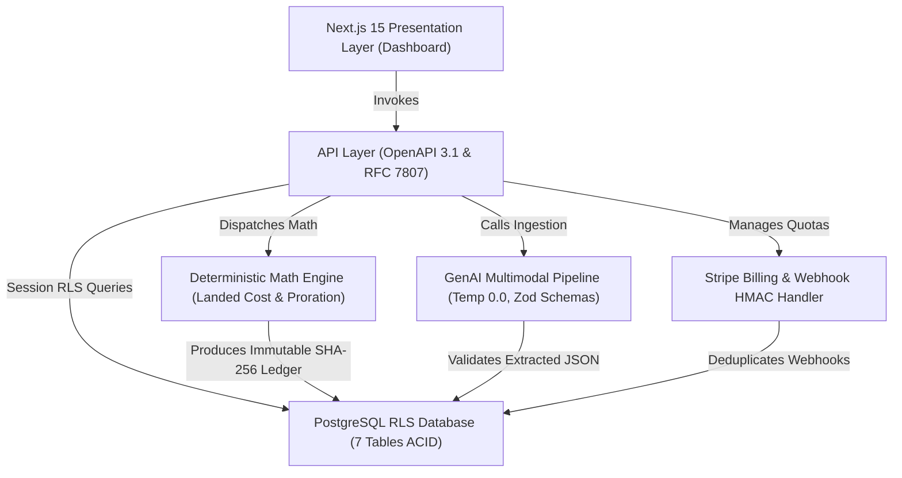

# ARCHITECTURE DESIGN & KNOWLEDGE GRAPH — LOGICLEAR AI

**Versión:** 1.0.0  
**Fecha:** 2026-10-09  
**Gobernanza:** Project Orchestrator V4.1  

---

## 1. Grafo de Conocimiento del Ecosistema

## 2. Invariantes del Sistema
- **Invariante 1 (Aislamiento):** Toda consulta a Postgres se ejecuta bajo sesión `app.current_tenant_id`.
- **Invariante 2 (Determinismo Matemático):** La suma de costos prorrateados por partida conserva al 100% el total declarado del expediente.
- **Invariante 3 (Cero Alucinación):** Si la suma de items difiere del total declarado en más de \$0.05, la ingesta es rechazada de inmediato.
- **Invariante 4 (Idempotencia de Pagos):** Ningún evento de webhook de Stripe se procesa más de una vez.
